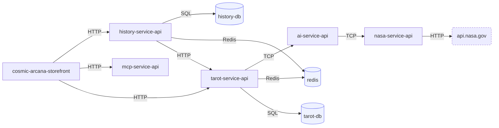
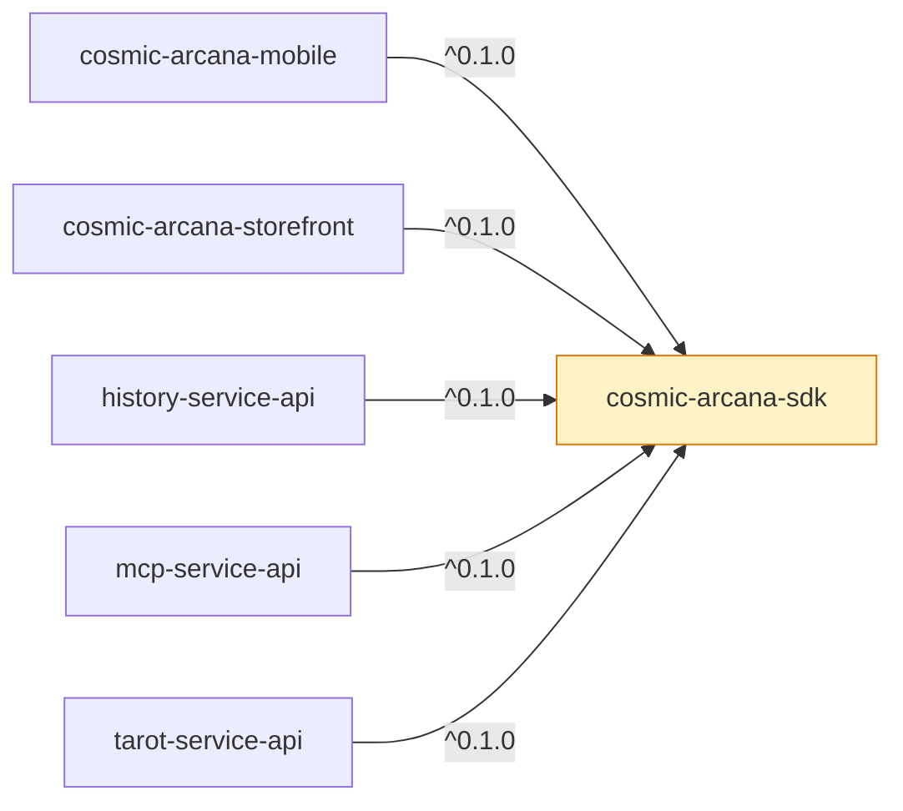

# Dependency graph

This page is generated, on 2026-10-12. Do not edit it by hand: run `npm run graph` in
`cosmic-arcana-infrastructure` to refresh it. Everything below is read from the repositories and from
GitHub's own dependency data; nothing is drawn from memory.

## Who calls whom

Read from the compose files that start the application for validation. An arrow means a service is
configured with the address of another; it is not a promise about traffic. Redis carries the BullMQ
queues, so two services pointing at it may be the producer and the consumer of the same event; the
contracts package says which. Dashed boxes are services outside this organization.

## Who depends on our contracts

Solid arrows are needed at runtime, dashed ones only to build or as a peer.

| Repository | Depends on | Version it asks for | Used at |
| --- | --- | --- | --- |
| cosmic-arcana-mobile | @cosmic-arcana/sdk | `^0.1.0` (git) | runtime |
| cosmic-arcana-storefront | @cosmic-arcana/sdk | `^0.1.0` (git) | runtime |
| history-service-api | @cosmic-arcana/sdk | `^0.1.0` (git) | runtime |
| mcp-service-api | @cosmic-arcana/sdk | `^0.1.0` (git) | runtime |
| tarot-service-api | @cosmic-arcana/sdk | `^0.1.0` (git) | runtime |

## Third-party footprint and open alerts

Direct and dev counts come from each `package.json`; the package total is what GitHub's dependency
graph sees in the lockfile; the alerts are Dependabot's open ones.

| Repository | Direct | Dev | Packages in the graph | Open alerts (critical / high / medium / low) |
| --- | ---: | ---: | ---: | --- |
| [ai-service-api](https://github.com/Cosmic-Arcana/ai-service-api/security/dependabot) | 12 | 23 | 668 | 3 / 8 / 9 / 1 |
| [arcana-prng-fingerprint](https://github.com/Cosmic-Arcana/arcana-prng-fingerprint/security/dependabot) | n/a | n/a | 7 | 0 / 0 / 1 / 0 |
| [arcana-rng-lab](https://github.com/Cosmic-Arcana/arcana-rng-lab/security/dependabot) | n/a | n/a | 6 | 0 / 0 / 0 / 0 |
| [cosmic-arcana-extension](https://github.com/Cosmic-Arcana/cosmic-arcana-extension/security/dependabot) | n/a | n/a | 2 | 0 / 0 / 0 / 0 |
| [cosmic-arcana-infrastructure](https://github.com/Cosmic-Arcana/cosmic-arcana-infrastructure/security/dependabot) | 1 | 0 | 9 | 0 / 0 / 0 / 0 |
| [cosmic-arcana-mobile](https://github.com/Cosmic-Arcana/cosmic-arcana-mobile/security/dependabot) | 18 | 2 | 569 | 0 / 3 / 2 / 0 |
| [cosmic-arcana-sdk](https://github.com/Cosmic-Arcana/cosmic-arcana-sdk/security/dependabot) | 0 | 6 | 328 | 2 / 0 / 2 / 0 |
| [cosmic-arcana-storefront](https://github.com/Cosmic-Arcana/cosmic-arcana-storefront/security/dependabot) | 8 | 12 | 435 | 3 / 5 / 6 / 1 |
| [history-service-api](https://github.com/Cosmic-Arcana/history-service-api/security/dependabot) | 17 | 25 | 847 | 2 / 3 / 3 / 1 |
| [mcp-service-api](https://github.com/Cosmic-Arcana/mcp-service-api/security/dependabot) | 10 | 23 | 674 | 3 / 7 / 12 / 1 |
| [nasa-service-api](https://github.com/Cosmic-Arcana/nasa-service-api/security/dependabot) | 11 | 23 | 668 | 3 / 8 / 9 / 1 |
| [tarot-service-api](https://github.com/Cosmic-Arcana/tarot-service-api/security/dependabot) | 19 | 26 | 849 | 0 / 3 / 1 / 1 |

## What to upgrade first

The same package often appears in several repositories, so one upgrade clears several alerts.
Worst severity first, then the package that touches the most repositories.

| Package | Worst | Repositories | Fixed in |
| --- | --- | --- | --- |
| `handlebars` | critical | 5: ai-service-api, cosmic-arcana-sdk, history-service-api, mcp-service-api, nasa-service-api | 4.7.10 |
| `proxy-addr` | critical | 3: ai-service-api, mcp-service-api, nasa-service-api | 2.0.8 |
| `next` | critical | 1: cosmic-arcana-storefront | 16.3.3 / 16.3.6 / 16.3.8 |
| `multer` | high | 5: ai-service-api, history-service-api, mcp-service-api, nasa-service-api, tarot-service-api | 2.3.0 / 2.4.0 |
| `js-yaml` | high | 4: ai-service-api, cosmic-arcana-storefront, mcp-service-api, nasa-service-api | 3.15.2 / 4.3.2 |
| `fast-uri` | high | 3: ai-service-api, mcp-service-api, nasa-service-api | 3.1.7 |
| `@nestjs/microservices` | high | 2: ai-service-api, nasa-service-api | 11.2.4 / 11.2.5 |
| `source-map-js` | high | 2: cosmic-arcana-mobile, cosmic-arcana-storefront | 1.2.2 |
| `braces` | high | 1: cosmic-arcana-mobile | none yet |
| `node-forge` | high | 1: cosmic-arcana-mobile | none yet |
| `sharp` | high | 1: cosmic-arcana-storefront | 0.35.4 / 0.35.5 |
| `sprintf-js` | medium | 5: ai-service-api, cosmic-arcana-sdk, history-service-api, mcp-service-api, nasa-service-api | none yet |

## GitHub's own views

Per repository: **Insights → Dependency graph** (every package, and what depends on it),
**Security → Dependabot** (the alerts), and **Insights → Dependency graph → Export SBOM**.

- [ai-service-api](https://github.com/Cosmic-Arcana/ai-service-api/network/dependencies)
- [arcana-prng-fingerprint](https://github.com/Cosmic-Arcana/arcana-prng-fingerprint/network/dependencies)
- [arcana-rng-lab](https://github.com/Cosmic-Arcana/arcana-rng-lab/network/dependencies)
- [cosmic-arcana-extension](https://github.com/Cosmic-Arcana/cosmic-arcana-extension/network/dependencies)
- [cosmic-arcana-infrastructure](https://github.com/Cosmic-Arcana/cosmic-arcana-infrastructure/network/dependencies)
- [cosmic-arcana-mobile](https://github.com/Cosmic-Arcana/cosmic-arcana-mobile/network/dependencies)
- [cosmic-arcana-sdk](https://github.com/Cosmic-Arcana/cosmic-arcana-sdk/network/dependencies)
- [cosmic-arcana-storefront](https://github.com/Cosmic-Arcana/cosmic-arcana-storefront/network/dependencies)
- [history-service-api](https://github.com/Cosmic-Arcana/history-service-api/network/dependencies)
- [mcp-service-api](https://github.com/Cosmic-Arcana/mcp-service-api/network/dependencies)
- [nasa-service-api](https://github.com/Cosmic-Arcana/nasa-service-api/network/dependencies)
- [tarot-service-api](https://github.com/Cosmic-Arcana/tarot-service-api/network/dependencies)
